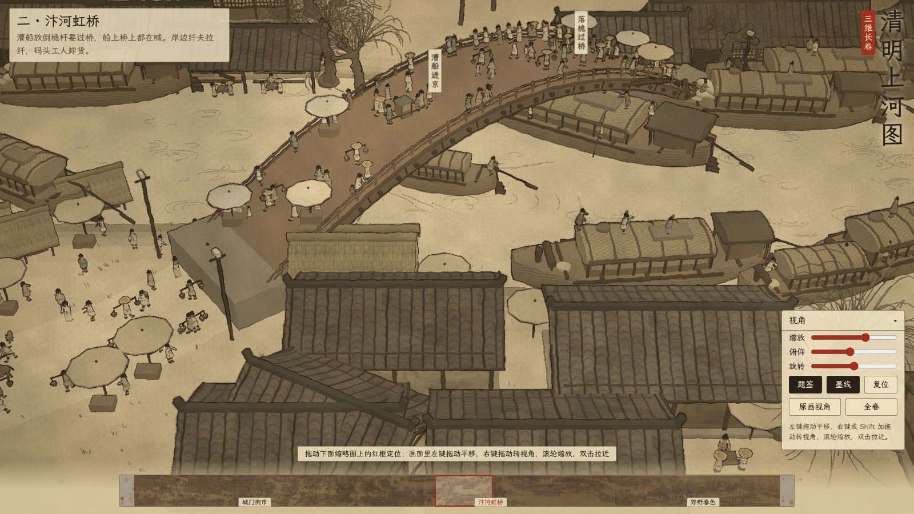
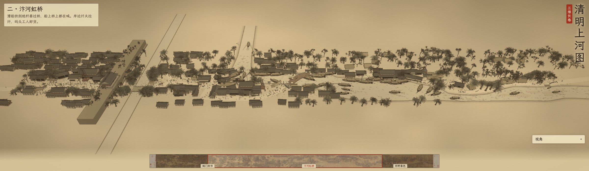
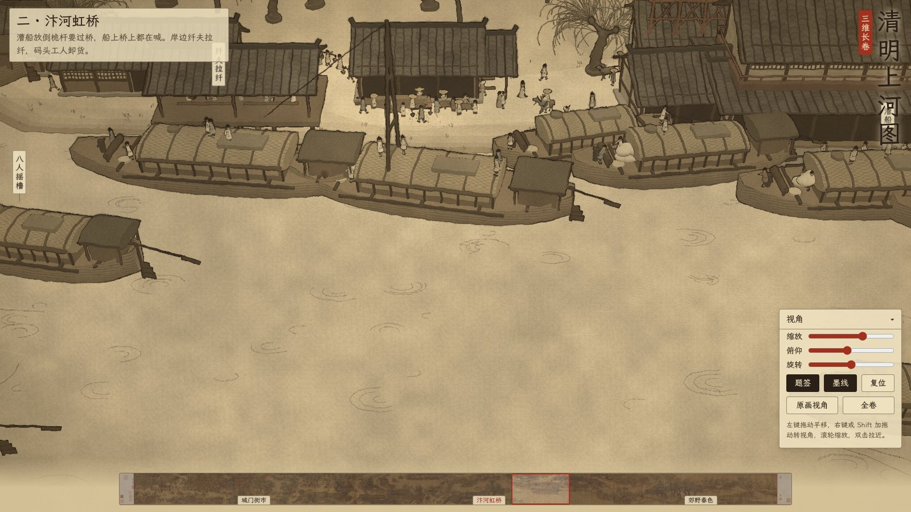
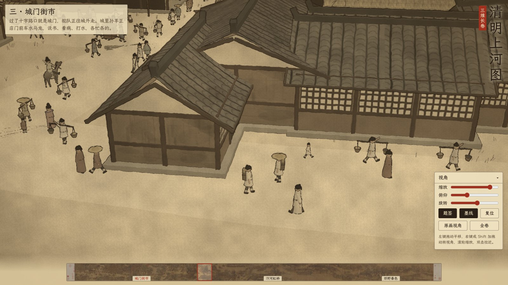
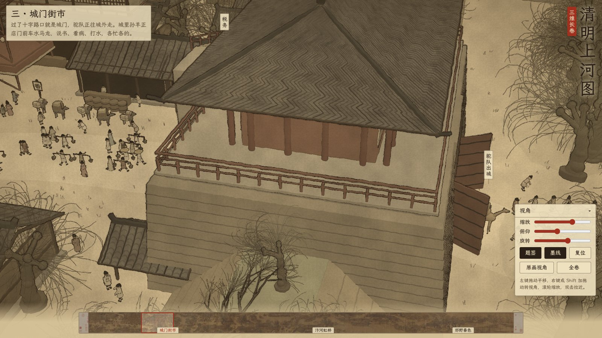
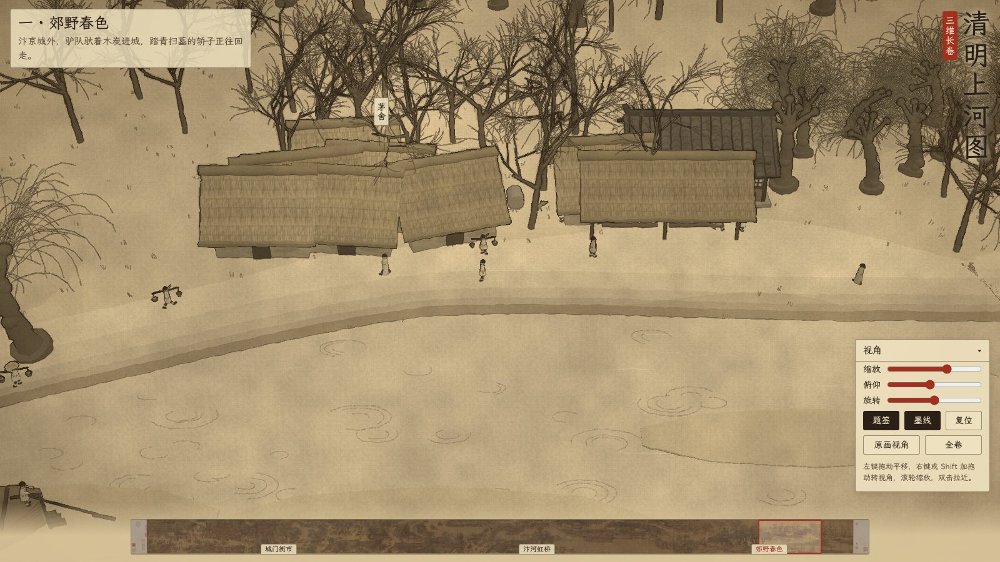

# Fable 5.2 白描改进版

在多轮版 [`../fable-5.2/`](../fable-5.2/) 的基础上，继续按人工反馈一轮轮改进，目标是尽量贴近原画。原来的 `fable-5.2/` 保持不动，作为和其他模型横向对比的基线。

在线查看：<https://gangtao.github.io/qingming-3d/fable-5.2-ink/>

## 相比多轮版改了什么

- **画风**：加了一层白描淡彩的后处理（`src/ink.js`）。先把场景画到离屏，用深度的二阶差分和亮度边缘勾墨线，再压低彩度、罩绢色、叠绢纹。右下角“墨线”按钮可以关掉对比。去掉了实时阴影和远山。
- **去模型感**：光照改成近乎平涂，不再有立体的明暗渐变；墨线取样加了低频抖动，线条有手抖、粗细和飞白；轮廓外有一圈积墨的淡晕；设色带浓淡和颗粒。墙面换成带水渍雨痕的罩染贴图，木构有顺纹，瓦面从圆滚滚的渐变改成手画的瓦垄线和瓦口短弧。
- **树**：柳树改成粗矮带树瘤的干，枝顶喷出一丛丛下垂的细线柳条。
- **城门和城墙**：城台改成四面收分的砖台，一层层砖缝；门洞有排叉柱、过梁、木栅门额和两扇城门；城楼有平坐斗拱、勾栏、格子窗、檐下斗拱和庑殿顶；城内有带栏杆的踏道。城墙从一整块厚板改成下宽上窄的矮土墙，墙头墙坡长满树，和原画里只见树不见墙的样子一致。
- **虹桥**：桥身两侧加拱肋、挡板和一排横木端头，拱抬高。
- **河面和地面**：河面撒墨线漩纹，河岸三层墨色晕染，地面加点苔和草。
- **人物**：衣色改成原画的白、米、浅褐为主。
- **船身**：船壳加深，露出带木板纹的船帮；舵改成藏在船尾下的小梯形舵叶，橹缩短；尾棚改成拱形席棚；船头加绞盘和横梁，篷顶放杂物。
- **行船**：九条过路船从卷首外驶来，穿过码头，钻过虹桥，拐出画面，带船头水纹。航道在加载时用动态规划算出，避开停泊的船和桥墩。目前都是同一个方向。
- **界面**：缩放范围放大到能把全卷收进一屏；底部缩略条按原画真实比例显示；加了“原画视角”“全卷”两个按钮；双击拉近。

## 截图

## 构建

`python3 src/build.py`，把 `src/` 里的模块拼成单文件 `index.html`（需要 fonttools 和 brotli）。

截图都是云端无头浏览器软件渲染的，没有在真机上测过帧率。
